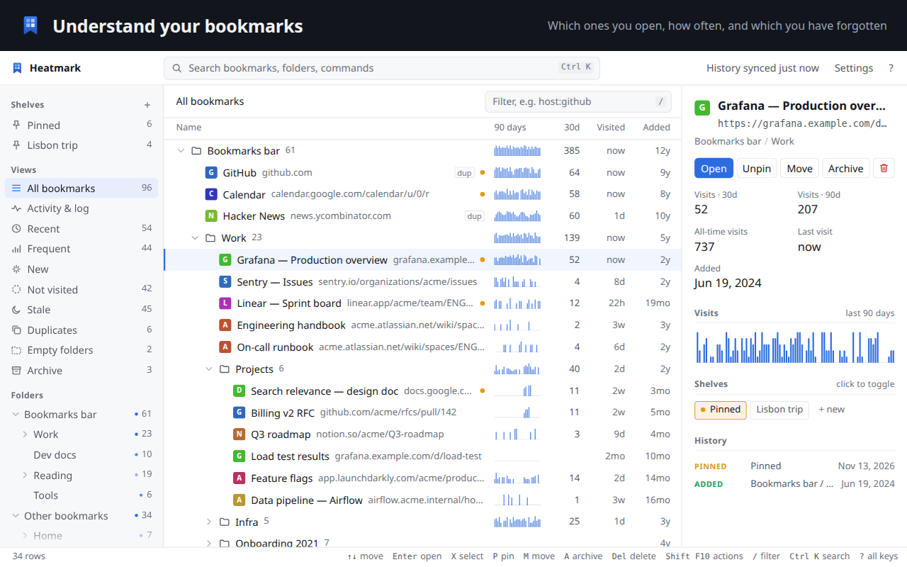

# Heatmark

[](https://github.com/gubenkoved/heatmark/actions/workflows/ci.yml)

**Understand your bookmarks.**

Bookmarks are how you get back to the information you rely on: the docs, dashboards, articles and
tools you return to. Heatmark shows how you actually use them (which ones you open, how often, and
which you have forgotten), keeps the important ones a keystroke away, and helps you clear out the
rest. It works on your real Chrome bookmarks, so Chrome Sync, the bookmarks bar and the address bar
keep working as before.



- **See what you use.** Visit counts and last-visit dates for every bookmark, read from your
  Chrome history. A 90-day sparkline per bookmark and per folder, and views for Recent, Frequent,
  Stale and Not visited.
- **Find anything in a keystroke.** `Ctrl+K` opens a palette with fuzzy search over titles, URLs
  and folders, ranked by how often and how recently you use each link. With an empty query it
  shows your shelves, then your recent links. The toolbar popup (`Alt+K`) is the same palette.
- **Keep what matters close.** Shelves are lists of pinned bookmarks: press `P` to pin, drag to
  reorder, `1`–`9` to jump between them. Switch on Shared in Settings to use the same shelves on multiple computers.
- **Slice and filter** the list with a small query language, for example
  `in:work host:github visited:>6mo -is:pinned`.
- **Clean up safely.** Archive, move and delete in bulk, with **Undo** for each. Duplicates and
  empty folders are found for you.
- **Never lose track.** A year heatmap and a day-by-day log of every bookmark change, whether
  made in Chrome, synced from another device or made here. Deleted items can be restored.
- **Right-click anything** (or press `Shift+F10`): bookmarks, selections, folders, shelves, log
  entries and palette results all have context menus.

## Install

Heatmark needs Chrome 114 or later.

### From source

There is no build step; Chrome loads the `extension/` folder as is.

1. Clone this repository and keep it where it is: Chrome loads the extension from that folder
   on every start.
2. Open `chrome://extensions` and turn on **Developer mode**.
3. Click **Load unpacked** and choose the repository's `extension/` folder.
4. Press `Alt+K` for the popup (change the shortcut at `chrome://extensions/shortcuts`), then
   **Full view ↗** (`Alt+O`) for the manager. Right-clicking the toolbar icon and choosing
   *Options* opens it too.

On first run Heatmark builds its change log from each bookmark's date added and reads your
history; that takes a few seconds.

### Moving to another install

For automatic shelf sync, install the same Heatmark build on both computers and choose
**Settings → Shelf storage → Shared** on each. To move local data, or transfer shelves between
different extension IDs such as an unpacked copy and the Chrome Web Store installation, use a file:

1. In the old install, open **Activity & log → Export JSON**.
2. Open the new install, then **Activity & log → Import JSON** (or `Ctrl+K` → "Import") and pick
   the file. Heatmark skips existing entries and merges pinned bookmarks into the active shelf
   collection by URL.
3. Remove the old install at `chrome://extensions`.

## Your data

Heatmark works with three kinds of data. Only one of them is its own.

**Your bookmarks belong to Chrome.** Heatmark keeps no copy of them. It reads them from Chrome
whenever you open it, and everything you do to them (rename, move, archive, delete) is a normal
Chrome bookmark change. Chrome Sync carries those changes to your other devices, and Chrome's
bookmarks bar and address bar always agree with what you see here.

**How often you visit them comes from your Chrome history.** Chrome remembers roughly the last
90 days of browsing. Heatmark looks up your bookmarked pages in that history and counts visits
per day; while Chrome is running it adds new visits as they happen.

**Heatmark keeps a few things of its own**, which Chrome doesn't:

| What | Why it's kept |
| --- | --- |
| Daily visit counts and the last visit time for bookmarked pages | So the record keeps growing after Chrome forgets history older than ~90 days. Only bookmarked pages: no other history, no page contents. |
| The change log | Every add, removal, move, rename, URL edit, archive and pin, with the full contents of deleted items so they can be restored. On first run it starts with an "Added" entry per bookmark, estimated from its date added. |
| Your shelves | Which bookmarks you pinned, on which shelf, in what order. |
| A few view settings | Which folders are expanded, which sections are collapsed, which log filters are on. |

**Where it lives.** Heatmark keeps this data in your Chrome profile by default. With Shared
selected, Chrome Sync carries the shared shelf names, pin references, order, and default shelf
through your Google account. The pin references use hashes of the bookmark URL and title plus
its creation time. Heatmark has no server and makes no direct network requests.

**Set up Shared shelves.** Sign in to the same Chrome account on each computer and enable
**Bookmarks** and **Extensions** in Chrome. Open **Settings** in Heatmark and choose **Shared**
on each computer that should use that collection. To bring over existing local shelves, click
**Copy local shelves to Shared**. Shelves with the same name are merged. Choose **Local** at any
time to return to that profile’s own shelves. Shared pins appear when their matching Chrome
bookmarks are available. If Chrome rejects a sync write, Heatmark keeps the edit on the device
and offers **Retry** in Settings.

**How it stays up to date:**

- **Bookmark changes** made anywhere (here, in Chrome's own UI, or by sync from another device)
  are logged the moment they happen, as long as Chrome is running.
- **Visits are re-checked against history** when Chrome starts, when you open the manager (at
  most every 10 minutes) and when you click *History synced* in the top bar. That also fills in
  visits made while the extension was off, if Chrome still has them.
- **Deletions in Chrome history are honored.** Clearing all history erases the visit counts;
  removing pages or recent time ranges removes those visits, for the ~90 days Chrome keeps history.

**You're in control:**

- **Export JSON** saves your bookmarks, the active shelves and their available pins, the change
  log, and visit counts to a file. Keep the file private.
- **Import JSON** merges shelves into the active collection and merges visit counts and the log locally.
- **Delete local data** (`Ctrl+K` → "Delete local data") erases Heatmark’s data and unsent shared
  edits from this profile, then switches to Local. Your Chrome bookmarks and shelves already
  saved to Chrome Sync remain available. Visit counts and the log are rebuilt.
- **Removing the extension** clears Heatmark’s local storage in that profile.

The formal statement is in [PRIVACY.md](PRIVACY.md).

## How it behaves

- **Archive** moves items into `Other bookmarks / Archive`. They stay synced but out of the way,
  and are hidden everywhere except the Archive view. Unarchive returns them to the folder they
  came from.
- **Delete** removes the real Chrome bookmark on every synced device. **Undo** restores it in
  place, and the log keeps the full item (folders with their contents) for a later restore.
  Restored items get new ids and a new date added. Deleting more than 25 bookmarks asks first.
- **Shelves** are kept by Heatmark. A pin leaves the original Chrome bookmark in its folder.
  Deleting a bookmark takes it off its shelves. Restoring from the log can pin it again in the
  active shelf collection.
- **Visits** count history entries for the bookmarked URL, ignoring reloads. URLs are compared
  without the `https://`, `www.` or a trailing slash. A visit to a *different* URL on the same
  site, such as a redirect target, doesn't count.
- **History before installation** goes back only as far as Chrome keeps it, about 90 days; the
  heatmap marks earlier days as unavailable. Bookmarks deleted before installation can't be
  recovered.

## Keyboard

In the manager:

| Key | Action |
| --- | --- |
| `Ctrl+K` · `Ctrl+P` | Palette: search bookmarks, folders and commands |
| `↑` `↓` · `J` `K` | Move; with `Shift`, extend the selection |
| `←` `→` · `H` `L` | Collapse / expand; `←` on a bookmark jumps to its folder |
| `Enter` | Open in a new tab (`Shift`: this tab, `Ctrl`: background). On a folder: expand, or open it in flat views |
| `X` · `Space` · `Ctrl+A` | Select a row / select all |
| `P` · `Shift+P` | Pin to the default shelf / pin to a shelf… |
| `M` | Move to a folder… |
| `A` | Archive / unarchive |
| `Delete` · `Backspace` | Delete (with Undo) |
| `E` · `F2` | Rename in the detail pane |
| `Alt+↑` `Alt+↓` | Reorder inside a shelf |
| `1`–`9` | Go to a shelf |
| `G` then `A` / `L` | Go to All bookmarks / Activity & log |
| `Shift+F10` · right-click | Actions for the row or selection |
| `/` | Filter the list |
| `Esc` | Clear the selection, then the filter |
| `I` | Show or hide the detail pane (in narrow windows) |
| `?` | All shortcuts |

In the palette: `Enter` opens, `Shift+Enter` opens in this tab, `Ctrl+Enter` opens in the
background and keeps the palette open, `Alt+P` pins, `Alt+Enter` shows the item in the tree.

## Filter syntax

Words must all appear in the title, URL or folder path. Add any of these terms; put a `-` in front
of a term to exclude matches, and quotes around values with spaces (`in:"side projects"`).

| Term | Matches bookmarks… |
| --- | --- |
| `in:work` | in a folder whose path contains "work" |
| `host:github` (or `site:`) | on a domain containing "github" |
| `url:docs` · `title:notes` | whose URL / title contains the text |
| `added:2024` · `added:2024-03` | added in 2024 / in March 2024 |
| `added:<2020` · `added:>2020` | added before 2020 / in 2020 or later |
| `added:<30d` · `added:>1y` | added within the last 30 days / more than a year ago |
| `visited:<7d` · `visited:>6mo` | last visited within 7 days / more than 6 months ago (or never) |
| `visited:never` | never visited |
| `visits:>5` · `visits:0` | with more than 5 recorded visits / none (also `<`, `>=`, `<=`) |
| `is:pinned` · `is:dup` · `is:archived` · `is:unvisited` | pinned / with duplicates / archived / never visited |
| `is:new` | added in the last 30 days |

Time units are `h`, `d`, `w`, `mo` and `y`. Archived bookmarks only show up when the query asks
for them (`is:archived` or `in:archive`).

## Known limits

- The list isn't virtualized; flat views stay responsive into the low thousands of rows.
- Rename, URL edits and deleting a shelf have no Undo (the log records them).

## Development

The shipped extension is plain JavaScript modules with no build step and no dependencies. The
development tools need Python 3.8+ and Node.js 22+.

```
extension/              the extension (load this folder)
  manifest.json         MV3: bookmarks, history, storage, unlimitedStorage, favicon, activeTab
  background.js         service worker: change log, visit recording, history sync, all shelf writes
  manager.html, .js     the full view; manager.js is the entry (palette, live updates, start-up)
  manager/state.js      shared state, routing, loading the model
  manager/list.js       sidebar, header, tree / flat table, status bar
  manager/detail.js     the detail pane
  manager/activity.js   heatmap and the day-by-day log
  manager/ops.js        operations: move, archive, delete, pin, restore, import / export
  manager/menus.js      context menus
  manager/input.js      keyboard, mouse, drag and drop, help, narrow-window panels
  popup.*               the toolbar popup (the palette, inline)
  lib/model.js          loads bookmarks, activity and shelves into one derived model
  lib/activity.js       history sync (history is authoritative inside Chrome's ~90-day window), live visits
  lib/store.js          shelves (written only by the worker) and the log
  lib/transfer.js       Import JSON: validated merge of an export (run by the worker)
  lib/palette.js        palette: search, folder picker, shelf picker
  lib/fuzzy.js          fzf-style matcher and highlighting
  lib/query.js          filter language
  lib/menu.js           context menus
  lib/dialog.js         in-app confirm / prompt dialogs
  lib/scrollbars.js     overlay scrollbars
  lib/tooltip.js        tooltips
  lib/bm.js, lib/ui.js  bookmark-tree helpers; DOM, formatting and chart helpers
dev/
  serve.py              dev server: the extension pages with a mock chrome.* API
  mock-chrome.js        the mock, backed by localStorage
  demo-data.js          made-up demo bookmarks and a year of visits
  real_data.py          read-only snapshot of a Chrome profile, for serve.py --real
  cdp.mjs               a small Chrome DevTools Protocol client shared by the two scripts below
  e2e.mjs               end-to-end test in headless Chromium (20 checks)
  screenshots.mjs       renders the store images from the demo data
  package.py            builds the store zip, with leak checks
  make_icons.py         renders extension/icons/*.png
store/                  the Chrome Web Store page: listing text, privacy declarations, images
```

Data in `chrome.storage.local`: `shelves`, `defaultShelf`, `act` (`{normUrl: {u, d: {day: visits},
last}}`), `actSyncedAt`, `trackingSince`, `archiveFolderId`, and one `log:<time>:<random>` key per
log entry. View settings live in the pages' `localStorage` under `bk:`.

### Preview without installing

```bash
python3 dev/serve.py                 # demo data at http://localhost:8765/manager.html (and /popup.html)
```

```bash
python3 dev/serve.py --real          # a read-only snapshot of your own Chrome profile, on :8778
```

`--real` defaults to `~/.config/google-chrome/Default` (Linux). Pass another profile folder on
macOS (`~/Library/Application Support/Google/Chrome/Default`) or Windows
(`%LOCALAPPDATA%\Google\Chrome\User Data\Default`). It reads the profile's bookmark files
(`Bookmarks` and/or `AccountBookmarks`) and a temporary copy of its History database, keeps visits
only for bookmarked URLs, listens on 127.0.0.1 only and writes nothing. Changes made in the preview
stay in the preview. `/__dev/reset` starts over.

### Test

```bash
node dev/e2e.mjs /path/to/chromium
```

The end-to-end test loads the extension into a throwaway profile and drives the real Chrome APIs:
visits, history deletion, palette, pinning, archiving, context menu, undo (including order and
mixed pins), import and the log. It
needs Chromium or Chrome for Testing (for example the build Playwright installs under
`~/.cache/ms-playwright/`), because branded Google Chrome ignores `--load-extension`. The browser
path can also come from the `CHROME` environment variable. It exits non-zero if any check fails.

CI runs `package.py` and this test in Chrome for Testing on every push and pull request
([`.github/workflows/ci.yml`](.github/workflows/ci.yml)).

After changing the code of a copy loaded in Chrome, click the reload icon on its card at
`chrome://extensions`; stored data survives reloads.

### Release

```bash
node dev/e2e.mjs /path/to/chromium           # must pass
node dev/screenshots.mjs /path/to/chromium   # when the UI changed: refreshes store/ images
python3 dev/package.py                       # → dist/heatmark-<version>.zip
```

1. Bump `version` in `extension/manifest.json` and add an entry to [CHANGELOG.md](CHANGELOG.md).
2. Update [store/README.md](store/README.md) in the same change when features or the UI changed.
3. Build with `package.py`. It validates the manifest, packs only `extension/` into a
   deterministic zip, and refuses to build if a shipping file contains a local path, an e-mail
   address, a network or dynamic-code call, a remote resource, a dev-only reference, a debug
   leftover, or an unexpected file.
4. Upload the zip in the Chrome Web Store Developer Dashboard.

## License

[MIT](LICENSE)
