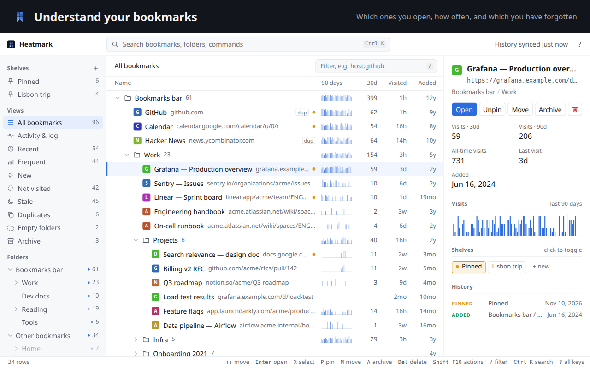
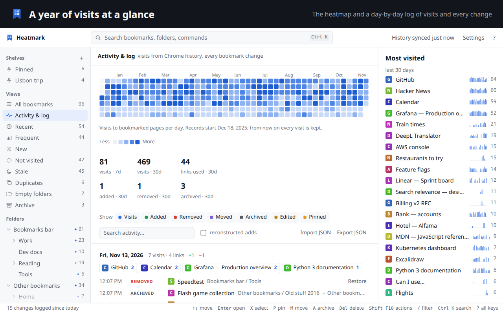
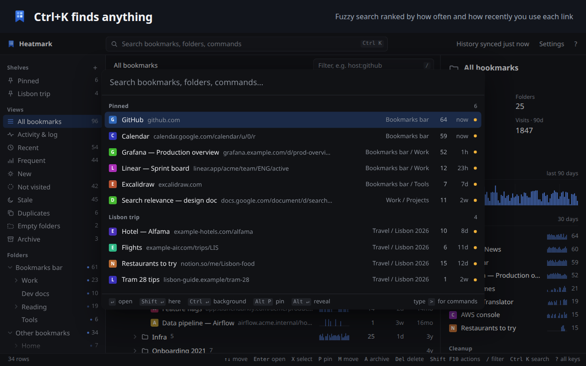
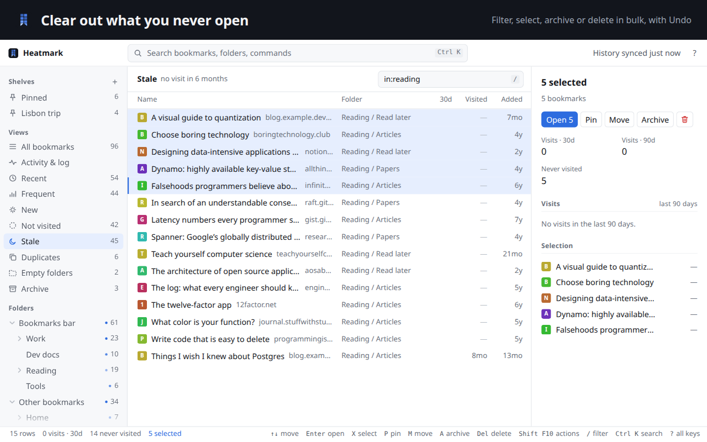
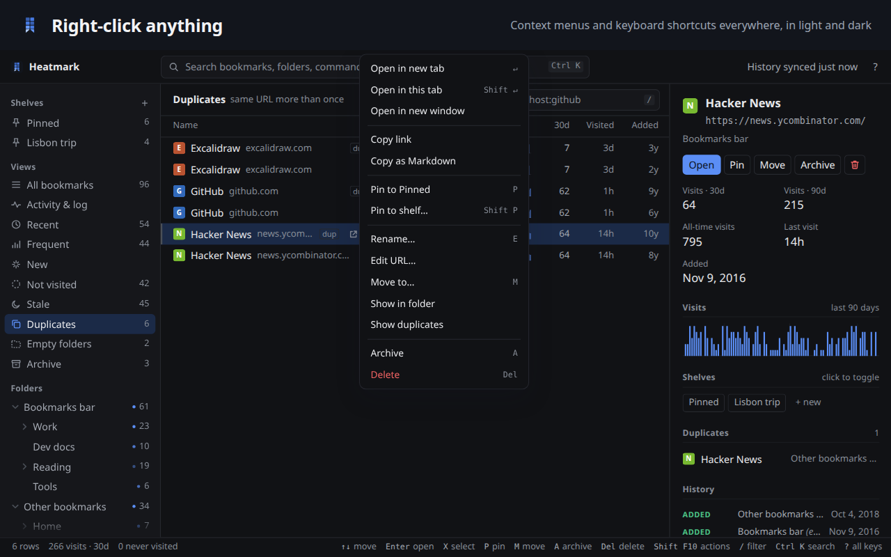

# Chrome Web Store page

The text and images published on Heatmark's Chrome Web Store page. They live in the repository
so they change together with the code, and so anyone can see how the extension describes itself
and why it asks for each permission.

<p>
  
  
  
  
  
</p>

## Listing

| Field | Value |
| --- | --- |
| Name | Heatmark |
| Summary | Understand your bookmarks: see which ones you use, keep the important ones a keystroke away, and clear out the rest. |
| Category | Productivity → Tools |
| Language | English |

The summary is the `description` in [`extension/manifest.json`](../extension/manifest.json)
(132 characters at most).

### Description for 1.1.0

Understand your bookmarks.

Bookmarks are how you find your way back to what you know: the docs, dashboards, articles and tools
you rely on. Over the years they pile up, and the ones that matter get buried among the ones you
forgot. Heatmark shows how you actually use them, keeps the important ones a keystroke away and
helps you clear out the rest, so your bookmarks work as a map to your information again.

**See what you use**
- Visit counts and last-visit dates for every bookmark, read from your Chrome history
- A 90-day sparkline per bookmark and per folder, plus Recent, Frequent, Stale and Not visited views
- A year heatmap and a day-by-day timeline of the bookmarks you opened

**Find anything in a keystroke**
- Ctrl+K palette with fuzzy search over titles, URLs and folders, ranked by how often and how
  recently you use each link
- With an empty query it shows your shelves, then your recent links
- The toolbar popup (Alt+K) is the same palette

**Pin what matters**
- Any number of shelves (pin lists): press P to pin, drag to reorder, 1–9 to jump between them
- Shelves are local by default. Choose Shared in Settings on each computer to sync shelves,
  pins and order through your Chrome account.

**Clean up safely**
- Filter with a small query language: `in:work host:github added:<2020 visited:>6mo is:dup`
- Right-click any bookmark, folder or selection: open, copy, pin, rename, move, archive, delete
- Archive, move or delete in bulk, with Undo
- Duplicates and empty folders are found for you

**Never lose track**
- A full log of every bookmark change, whether made in Chrome, synced from another device or made here
- Deleted bookmarks and folders can be restored from the log

**Private by design**
- Heatmark has no server, sends no direct network requests and has no analytics
- Visit counts for bookmarked pages and the change log stay on your device
- Works on your real Chrome bookmarks, so Chrome Sync, the bookmarks bar and the address bar keep working

<details>
<summary>Plain text for the Chrome Web Store</summary>

```text
Understand your bookmarks.

Bookmarks are how you find your way back to what you know: the docs, dashboards, articles and tools you rely on. Over the years they pile up, and the ones that matter get buried among the ones you forgot. Heatmark shows how you actually use them, keeps the important ones a keystroke away and helps you clear out the rest, so your bookmarks work as a map to your information again.

SEE WHAT YOU USE
• Visit counts and last-visit dates for every bookmark, read from your Chrome history
• A 90-day sparkline per bookmark and per folder, plus Recent, Frequent, Stale and Not visited views
• A year heatmap and a day-by-day timeline of the bookmarks you opened

FIND ANYTHING IN A KEYSTROKE
• Ctrl+K palette with fuzzy search over titles, URLs and folders, ranked by how often and how recently you use each link
• With an empty query it shows your shelves, then your recent links
• The toolbar popup (Alt+K) is the same palette

PIN WHAT MATTERS
• Any number of shelves (pin lists): press P to pin, drag to reorder, 1–9 to jump between them
• Shelves are local by default. Choose Shared in Settings on each computer to sync shelves, pins and order through your Chrome account.

CLEAN UP SAFELY
• Filter with a small query language: in:work host:github added:<2020 visited:>6mo is:dup
• Right-click any bookmark, folder or selection: open, copy, pin, rename, move, archive, delete
• Archive, move or delete in bulk, with Undo
• Duplicates and empty folders are found for you

NEVER LOSE TRACK
• A full log of every bookmark change, whether made in Chrome, synced from another device or made here
• Deleted bookmarks and folders can be restored from the log

PRIVATE BY DESIGN
• Heatmark has no server, sends no direct network requests and has no analytics
• Visit counts for bookmarked pages and the change log stay on your device
• Works on your real Chrome bookmarks, so Chrome Sync, the bookmarks bar and the address bar keep working
```

</details>

## Images

All images are rendered from made-up demo data ([`dev/demo-data.js`](../dev/demo-data.js)) by
`node dev/screenshots.mjs <path-to-chromium>`; none of them shows real bookmarks or history. Each
screenshot carries a caption band, since the store shows them small.

| File | Size | Shows |
| --- | --- | --- |
| [`screenshot-1-tree.png`](screenshot-1-tree.png) | 1280×800 | "Understand your bookmarks": the folder tree with sparklines and the detail pane |
| [`screenshot-2-activity.png`](screenshot-2-activity.png) | 1280×800 | "A year of visits at a glance": heatmap, totals and the day-by-day log |
| [`screenshot-3-palette.png`](screenshot-3-palette.png) | 1280×800 | "Ctrl+K finds anything": the palette with shelves and recent links |
| [`screenshot-4-cleanup.png`](screenshot-4-cleanup.png) | 1280×800 | "Clear out what you never open": the Stale view with a selection and bulk actions |
| [`screenshot-5-dark.png`](screenshot-5-dark.png) | 1280×800 | "Right-click anything": the context menu on duplicates, in dark mode |
| [`promo-small-440x280.png`](promo-small-440x280.png) | 440×280 | Small promo tile |
| [`icon-128.png`](icon-128.png) | 128×128 | Store icon: the extension icon at 96×96 on a transparent margin, as the store guidelines ask |

## Privacy practices

Privacy details for this release. The full policy is [PRIVACY.md](../PRIVACY.md).

**Single purpose:** help users organize and navigate their Chrome bookmarks: see which bookmarks
they actually use, pin the important ones, clean up the rest, and keep a history of changes.

| Permission | Why it is needed |
| --- | --- |
| `bookmarks` | The core function: showing, searching, moving, archiving and deleting your bookmarks at your request, and logging changes so deleted items can be restored. |
| `history` | Showing how often and when each bookmarked page was visited. Only per-day visit counts for bookmarked pages are stored, on the device; other history is never stored. |
| `storage` | Keeping shelves, the change log and visit counts. Shared uses Chrome Sync for shelf names, pin references, order and the default shelf. |
| `unlimitedStorage` | The change log (which keeps deleted items for restore) and the long-term visit record grow over time and can exceed the default 10 MB quota for large collections. |
| `favicon` | Showing each site's icon next to its bookmark, from Chrome's local icon cache. |
| `activeTab` | When you open the toolbar popup, reading the current tab's address and title to offer "Pin this page". Nothing is stored unless you choose it. |

**Remote code:** none. All code ships in the package; there are no external scripts, no `eval`
and no direct network requests. Shared shelves use Chrome’s built-in sync service.

**Data use:** visit counts and the change log are stored on the device. If a user enables Shared,
Chrome Sync stores shelf names, order, the default shelf and pin references in the user’s Google
account. Pin references include hashed bookmark URLs and titles and bookmark creation times.
Heatmark uses this data for the purpose above and does not sell it or use it for advertising,
creditworthiness or lending.
